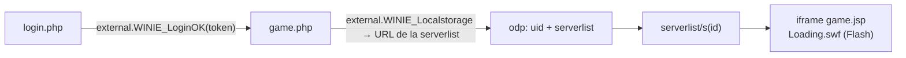

<div align="center">

# ⚔️ Legend Online para Linux

**Juega Legend Online de forma nativa en Linux, sin Wine, sin Bottles y sin el launcher de Windows.**


[Instalación](#-instalación) · [Uso](#-uso) · [Cómo funciona](#-cómo-funciona) · [Problemas](#-problemas-conocidos) · [Apóyame ☕](#-apoya-el-proyecto)

</div>

---

## ✨ Qué es

El launcher oficial de Legend Online es una app de Windows (WinForms + CefSharp) que solo envuelve
un navegador Chromium con el plugin de Flash. Este proyecto replica ese **envoltorio** para Linux:

- 🐧 **Nativo**: Electron 11 + Flash PPAPI para Linux. Nada de Wine.
- 🔑 **Login normal** con usuario y contraseña, igual que en el launcher oficial.
- 🖥️ **Zoom automático**: el juego llena la ventana en lugar de quedarse en un recuadro de 1495×895 con bordes negros.
- 🎨 **Mejor calidad al ampliar**: Flash en calidad `best` (imágenes suavizadas al escalar).
- 🔒 **Aislado**: corre dentro de [bubblewrap](https://github.com/containers/bubblewrap); no ve tu carpeta personal.
- 🪟 Probado en **Arch + Hyprland**; debería ir en KDE Plasma, GNOME, Sway o X11.

> [!IMPORTANT]
> Proyecto **no oficial**, sin relación con OASIS Games ni Creaction Network.
> No modifica el juego, ni el tráfico, ni el protocolo: el servidor sigue validando todo.
> Úsalo bajo tu propia responsabilidad y respeta los términos de servicio del juego.

## 📋 Requisitos

- Linux **x86_64** (no existe Flash para ARM).
- Sesión **X11** o **Wayland con XWayland**.
- `curl`, `python3` y `tar` (para el instalador), `bubblewrap` y `xdg-open`.
- Las bibliotecas que usa Electron 11. En un escritorio normal casi siempre están ya instaladas.

<details>
<summary><b>Arch / Manjaro / EndeavourOS</b></summary>

```bash
sudo pacman -S --needed bubblewrap xdg-utils xorg-xwayland gtk3 nss alsa-lib libcups mesa \
  libdrm libxkbcommon at-spi2-core libxcomposite libxdamage libxrandr libxext libxfixes dbus expat
```
</details>

<details>
<summary><b>Fedora</b></summary>

```bash
sudo dnf install bubblewrap xdg-utils xorg-x11-server-Xwayland gtk3 nss alsa-lib cups-libs \
  mesa-libgbm libdrm libxkbcommon at-spi2-core libXcomposite libXdamage libXrandr libXext \
  libXfixes dbus-libs expat
```
</details>

<details>
<summary><b>Debian / Ubuntu / Mint</b></summary>

```bash
sudo apt install bubblewrap xdg-utils xwayland libgtk-3-0 libnss3 libasound2 libcups2 libgbm1 \
  libdrm2 libxkbcommon0 libatk-bridge2.0-0 libatspi2.0-0 libxcomposite1 libxdamage1 libxrandr2 \
  libxext6 libxfixes3 libdbus-1-3 libexpat1
```

En Ubuntu 24.04+ / Debian 13+ algunos paquetes llevan sufijo `t64`
(`libasound2t64`, `libgtk-3-0t64`, `libcups2t64`, `libatk-bridge2.0-0t64`).
Ubuntu 24.04+ además bloquea bubblewrap con AppArmor: arranca con `LO_NO_BWRAP=1 ./run.sh`.
</details>

`run.sh` comprueba al arrancar si falta alguna biblioteca y te dice cuál.

## 🚀 Instalación

```bash
git clone https://github.com/kevinsamaca0907-cell/legend-linux.git
cd legend-linux
./instalar.sh
```

`instalar.sh` descarga y **verifica con SHA-256**:

| Herramienta | Origen | Tamaño |
|---|---|---|
| Electron 11.5.0 | [Releases oficiales de Electron](https://github.com/electron/electron/releases/tag/v11.5.0) | ~80 MB |
| Flash Player 32.0.0.344 (PPAPI, Linux) | Archivo oficial de Adobe guardado en [Wayback Machine](https://web.archive.org/) (mayo de 2020) | ~406 MB (se borra tras extraer) |

> [!NOTE]
> Estos binarios **no están en el repositorio**: Electron por tamaño y Flash porque la licencia de Adobe
> no permite redistribuirlo. Por eso cada uno los descarga de la fuente original.
> Se usa la 32.0.0.344 porque es la última versión **sin la "bomba de tiempo"** que bloquea Flash desde enero de 2021.

## 🎮 Uso

```bash
./run.sh
```

1. Se abre la ventana de login: entra con tu usuario y contraseña (Facebook/Google aún no están soportados).
2. El cliente te lleva a tu último servidor jugado.
3. La sesión y los ajustes se guardan en `./perfil` (**no lo compartas**: contiene tu sesión).
   Con "recordar contraseña" marcado, el usuario y la contraseña se guardan en `perfil/usuarios.json`
   (permisos 600, en base64: **no está cifrada**, igual que en la práctica el launcher oficial). Si no lo marcas, solo se guarda el usuario.
4. El botón de cambiar de servidor abre otra ventana del cliente: puedes tener varios servidores abiertos a la vez.

### 🖥️ Acceso directo en el menú

```bash
./instalar-escritorio.sh              # menú de aplicaciones (KDE, GNOME, XFCE...)
./instalar-escritorio.sh --escritorio # además, icono en el escritorio
./instalar-escritorio.sh --quitar     # quitarlo
```

Solo escribe en `~/.local/share` (sin sudo). Si mueves la carpeta del cliente, vuelve a ejecutarlo.

### ⌨️ Teclas (ventana del juego)

| Tecla | Acción |
|---|---|
| `Ctrl` `+` / `Ctrl` `-` | Zoom manual |
| `Ctrl` `0` | Zoom automático (llenar la ventana) |

### ⚙️ Variables opcionales

| Variable | Efecto |
|---|---|
| `LO_NO_BWRAP=1` | Arranca sin bubblewrap (menos seguro) |
| `LO_CALIDAD=high` | Calidad de Flash original (por defecto `best`) |
| `LO_DEVTOOLS=1` | Abre las DevTools |
| `LO_DIAG=1` | Registros de depuración (`.swf` cargados, tamaños del juego) |
| `LO_FLASH_PATH=/ruta/libpepflashplayer.so` | Usa otro plugin de Flash |

Ejemplo: `LO_CALIDAD=high ./run.sh`

### 🌍 Otros idiomas / servidores

Cambia `language` en [`src/config.js`](src/config.js) (`de`, `es`, `pt`, `tr`, `ar`, `sv`, `el`, `nl`, `pl`).

### 📦 Llevarlo a otro equipo

`./empaquetar.sh` crea `dist/legend-linux-AAAAMMDD.tar.gz` (~82 MB) con todo lo necesario y sin tu sesión.
Es **solo para tus equipos**: incluye el plugin de Flash, que no se puede redistribuir.

## 🧠 Cómo funciona

El cliente reproduce lo que hace el launcher oficial (analizado con `ilspycmd`):



- **`window.external`**: las páginas del juego llaman a métodos `WINIE_*` del launcher. `src/preload.js` los
  expone con un `Proxy` que los reenvía por IPC al proceso principal (`src/main.js`), que responde igual que el original.
- **Cookies**: como el launcher, añade `logintype=4` y `new_gamebox=1`.
- **Zoom**: `game.jsp` fija el juego en 1495×895 px. Flash escala con el zoom de página de Chromium, así que
  el cliente calcula el zoom para llenar la ventana y lo recalcula al cambiar su tamaño.

## 🔒 Seguridad

Electron 11 (Chromium 87) y Flash 32 **ya no reciben parches**, así que el cliente se diseñó para que un fallo
en ellos haga el menor daño posible:

| Medida | Qué evita |
|---|---|
| Todo corre dentro de **bubblewrap** | No ve tu carpeta personal (`~/.ssh`, `~/.config`, navegadores...), ni D-Bus, ni el socket de Wayland, ni otros procesos |
| Proyecto en **solo lectura** (solo `perfil/` es escribible) | Que un proceso comprometido modifique `run.sh` o `src/` para ejecutarse fuera del sandbox la próxima vez |
| **Permisos web denegados** (solo se permite pantalla completa) | Que una página use cámara, micrófono, ubicación, notificaciones o **lea tu portapapeles** (Electron los concede por defecto) |
| **iframes de terceros bloqueados** (widget de Facebook, rastreadores) | Código ajeno ejecutándose dentro del navegador sin parches |
| `window.external` **solo en los dominios del juego** | Que un iframe ajeno llame a las funciones del launcher |
| **Descargas bloqueadas** | Que una página te deje archivos |
| Navegación solo a `*.creaction-network.com` y `*.oasgames.com` | Enlaces y popups ajenos se abren en tu navegador normal (como mucho uno por segundo); los popups del juego (p. ej. cambiar de servidor) abren otra ventana del cliente (sesión en memoria propia con las cookies del juego copiadas), máximo 8 |
| Certificados TLS verificados | El launcher oficial los ignora; aquí no |
| Logs sin tokens ni claves de sesión | Filtrar tu sesión al compartir la salida de la terminal |

Puedes comprobarlo tú mismo:

```bash
./run.sh --probar-sandbox                                   # comprobaciones desde dentro del sandbox (+ DNS y X11)
./tools/electron-v11.5.0/electron scripts/pruebas-seguridad  # página hostil: permisos, iframes, descargas
SIN_SEGURIDAD=1 ./tools/electron-v11.5.0/electron scripts/pruebas-seguridad  # control: así sería sin protecciones
```

**Riesgos que quedan** (inherentes a usar Flash en 2026):

- Chromium 87 y Flash 32 tienen vulnerabilidades conocidas sin parchear. El sandbox limita el daño, pero no las elimina.
- Electron corre con `--no-sandbox` (el sandbox interno de Chromium 87 mata a Flash con la glibc actual); bubblewrap lo sustituye.
- El acceso a X11 (XWayland) no está aislado: un proceso comprometido podría ver o simular teclas en **otras apps X11**
  (no en las apps Wayland nativas).
- La red no está restringida (el juego la necesita) y los scripts de terceros de la página principal (p. ej. el SDK de
  Facebook en el login) se siguen cargando; se listan en la terminal como `[seguridad] recurso de terceros`.
- Usa una contraseña que no repitas en otros sitios.

## 🩹 Problemas conocidos

| Problema | Solución |
|---|---|
| Se ve borroso o pequeño con escalado 125 % / 150 % en Wayland | KDE: *Pantalla → Escalado de aplicaciones X11 → que se escalen ellas mismas*, o ajusta con `Ctrl` `+`/`-` |
| Barras negras a los lados | Es la relación de aspecto del juego (1495×895) frente a la de tu pantalla |
| Las imágenes se ven algo suaves al ampliar | Son bitmaps a resolución nativa; `Ctrl` `-` para más nitidez y menos tamaño |
| "Couldn't load plugin" | Arranca siempre con `./run.sh` (añade los parámetros que necesita Flash) |
| No carga nada / no abre la ventana | `./run.sh --probar-sandbox`: la sección "Necesario para jugar" dice si falla el DNS o X11 |
| Faltan bibliotecas | Instala los paquetes de tu distro de [Requisitos](#-requisitos) |
| Login con Facebook / Google | Aún no soportado |

## 📁 Estructura

```
legend-linux/
├── src/
│   ├── main.js       # ventanas, puentes WINIE_*, cookies, zoom, navegación permitida
│   ├── preload.js    # window.external, calidad de Flash, diagnóstico
│   ├── seguridad.js  # permisos, descargas e iframes de terceros
│   └── config.js     # URLs, idioma y versión del launcher
├── run.sh            # arranque dentro de bubblewrap
├── instalar.sh       # descarga y verifica Electron + Flash
├── empaquetar.sh     # paquete para tus otros equipos
├── instalar-escritorio.sh # acceso directo en el menú / escritorio
├── iconos/           # icono en varios tamaños (fuente.png = original)
└── scripts/
    ├── fetch_pages.py      # descarga las páginas del launcher para analizarlas
    ├── probar-sandbox.sh   # comprobaciones dentro de bubblewrap (./run.sh --probar-sandbox)
    ├── pruebas-seguridad/  # página hostil contra src/seguridad.js y src/preload.js
    └── flash-test/         # pruebas aisladas de Flash (carga y zoom)
```

## ☕ Apoya el proyecto

Si te sirvió para jugar en Linux y quieres apoyarme, ¡invítame un café! 😄

<a href="https://ko-fi.com/shirogura" target="_blank">
  
</a>
<a href="https://github.com/sponsors/kevinsamaca0907-cell" target="_blank">
  
</a>

También ayuda mucho dejar una ⭐ al repo o abrir un *issue* si algo falla en tu distro.

## 📜 Créditos y licencias

- Código de este proyecto: [MIT](LICENSE) © 2026 Shirogura.
- [Electron](https://www.electronjs.org/) (MIT).
- Adobe Flash Player © Adobe: no se incluye ni se redistribuye; `instalar.sh` lo descarga del archivo oficial de Adobe.
- Legend Online © OASIS Games / Creaction Network. Este proyecto no está afiliado a ellos.
